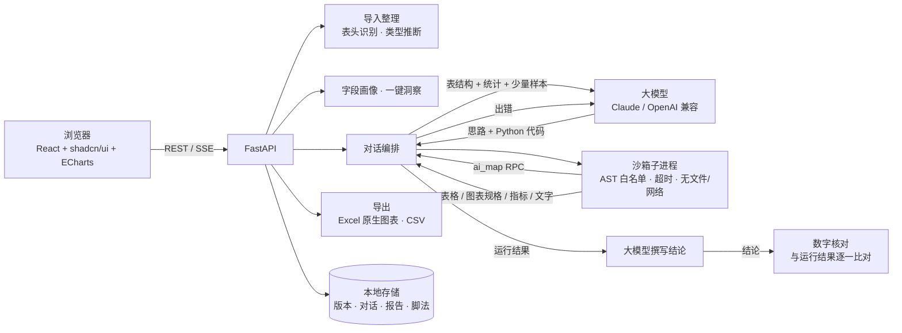

# SheetWise · 智能表格分析

上传 Excel，**勾选列，用一句话提出需求**，SheetWise 会像一位资深数据分析师一样：自动整理杂乱的表格、编写并在本机运行 pandas 代码、给出图表与结论，还能把整个处理流程保存下来，下个月的新表一键复用。


## 功能一览

| | |
|---|---|
| **智能导入** | 自动识别表头位置（跳过大标题、说明行）、合并两级表头、一个工作表里用空行隔开的多张表分别导入、去掉表尾「制表人/备注」、纵向合并的分组单元格向下填充；把 `¥1,200.50` / `12.5%` / `1.5万` / SAP 末尾负号 `1,234.00-` / 全角数字转成数值，`2024年1月5日`、Excel 日期序列号转成日期；身份证号、编号、000000 格式的工号和邮编保留为文本（前导 0 不丢）；年份 / 月份作表头的宽表提示可一键转为长表；表尾「合计」行在数值核对无误后自动移除（可撤销）。公式没有保存结果、Excel 错误值（#DIV/0!、#N/A）、隐藏的行列和筛选都会在导入说明里写明。支持 xlsx / xls / csv（自动识别 GBK 编码）、多个工作表与多个文件，上传有进度、可取消 |
| **勾选列 + 自然语言** | 在表格中勾选关心的字段、像 Excel 一样按列筛选，再用中文描述需求。AI 编写代码 → 本机沙箱执行 → 出错自动修正（最多 3 次）→ 流式输出结论。可以写下工作区的「口径与规则」（如「销售额不含退货」），每次提问都会遵守 |
| **数字可核对** | 结论里的每个数字都和这一轮的计算结果逐一比对：悬停看出处、点击跳到对应的指标卡 / 表格 / 图表；计算结果里找不到的数字会标黄提醒核对。报告里的每一项都记录数据来源（表、版本、行数、筛选、问题、模型） |
| **图表** | 折线、面积、柱状、条形、堆叠、饼图/环形、散点（含趋势线）、直方图、箱线图、热力图、漏斗图；一键切换图表类型，下载 PNG / SVG，查看数据表 |
| **AI 逐行处理** | 打开开关后，AI 可以逐条理解文本：评论情感分析、工单分类、信息提取、地址规范化……重复值只处理一次；结果缓存在本机，重跑不重复付费；个别批次失败时留空并提示，不影响其他行 |
| **一键洞察（无需 AI）** | 数据质量评分、关键指标卡（含环比）、数据体检（重复行、合计行、缺失值、数字存成文本、首尾空格……一键修复）、推荐图表、字段画像、推荐问题；大表在导入后就在后台算好 |
| **快捷分析（无需 AI）** | 根据勾选列的类型给出：趋势、分组对比、占比、分布、异常值、相关性、交叉分析、透视表、宽表转长表，以及删除重复行、填充缺失值、转数值/日期等清洗操作 |
| **多表：对账、查找匹配、上下合并（无需 AI）** | 按订单号等键列把两张表对上：匹配率、只在 A / 只在 B 的记录、两边都有但金额不一致的单号，每条附原表行号。比对前先统一写法（空格、全角半角、大小写、`1001.0` 与 `1001`、文字日期、带千分位的金额），同一个键出现多次时按键求和后再比；支持容差和多列组合键；只差前导零的编号会单独提示。「查找匹配」是先统一写法的 VLOOKUP：把 B 表的列带到 A 表，给出匹配率和没找到的行，B 里重复的键会明确提示。「上下合并」把每月一张的表接起来，列名写法不同（「金额（元）」与「金额」）时按基准表自动对齐、可手动调整，结果另存为新表并标明来源。生成的代码可查看，可存成脚法，下个月换新表一键重跑 |
| **像 Excel 一样看表** | 按列筛选、排序、搜索；冻结到某一列、隐藏列（只影响显示）；列宽可拖动，列头有分布迷你图 |
| **版本与可控** | 每次修改数据都生成新版本，可撤销/重做、恢复任意版本、查看当时运行的代码；「停止」立即生效；两个分析同时修改同一张表时不会互相覆盖；删除、清空前都会确认 |
| **报告与导出** | 把图表、表格、结论钉到报告里；导出 **Excel（原生可编辑图表）**、独立 HTML（矢量图，离线可看）、打印为 PDF；身份证号等长数字在 Excel 里保持原样；CSV 可选「Excel 打开用」（编号不变形）；超过 104 万行的表自动拆到多个工作表；大表导出时内存不随行数增长，5 万行以上的表在后台生成，提示里显示进度、可以随时取消，生成好后自动下载；**按原文件格式导出**：写回你上传的 Excel，标题、表头样式、合计行、签字行和其他工作表原样保留，合计公式随行数调整；原来每行同一个公式的列（如 金额 = 单价 × 数量）在确认结果与当前数据一致时写回公式，否则写回数值并说明原因；**按列拆分**成多个工作表或多个文件（zip）；汇总结果可导出**公式版 Excel**：附上源数据，汇总数字写成 SUMIFS / COUNTIFS 等公式（逐格核对过与结果一致才写），点开就能看到每个数怎么来的 |
| **脚法复用** | 把一次成功的清洗+分析流程保存为「脚法」，新表一键重放（不再调用 AI 写代码，零成本、可复现；含「AI 逐行处理」的步骤会在套用对话框里请你同意后才发送文本）；新表列名变了可以指定对应列；中途失败会撤回已做的修改，不留下半成品；脚法可**导出为文件**发给同事，对方导入后直接套用（导入时检查格式，并提示只导入可信来源的脚法） |
| **成本透明** | 每条回答显示用了多少 token、多少来自缓存；Claude 官方接口按标价估算费用。自动使用提示缓存，追问和自动修正更快、更省 |
| **多模型** | Claude（Anthropic 官方 SDK）以及任意 OpenAI 兼容接口：DeepSeek、通义千问、Kimi、智谱、豆包、硅基流动、OpenRouter、Ollama 本地模型等 |
| **网络代理** | 访问模型 API 可选「不使用代理 / 使用系统代理（默认）/ 手动配置」：HTTP、HTTPS、SOCKS5 代理，可带用户名密码，可直接粘贴 `http://127.0.0.1:7890` 这样的完整地址，常用代理软件端口一键填入；「不使用代理的地址」支持 `*.example.com`、网段和 `<local>`，本地模型默认直连；保存前可「检测代理」，说明走的哪条路、用时多少、失败原因（连不上代理、需要登录、超时）。代理密码与 API Key 一样只发往保存时的那台代理服务器 |
| **隐私** | 计算全部在本机完成。三种模式：**脱敏样本**（默认，手机号、身份证、银行卡、邮箱、姓名、地址自动打码）、完整样本、**仅结构**（不发送任何单元格内容）；发送给模型的内容可以随时预览。只有开启「AI 逐行处理」时才发送相关列的内容 |
| **反馈** | 每条回答下可以选「有帮助 / 不对」并说明原因；反馈只保存在本机，可在设置中导出（敏感信息自动打码） |

窄屏下数据表列表和 AI 面板会收进抽屉；列头支持键盘操作。

### 截图

勾选列 → 提问 → 指标卡、图表、表格与结论：


结论里的数字逐一核对：悬停看出处、点击跳到对应结果，计算结果里找不到的数字标黄（示例中「47.2%」是模拟模型故意编造的）：


AI 逐行处理（客户评价情感分析），结果写回表格并生成可撤销的新版本：


一键洞察（浅色 / 深色）：


报告、版本历史与模型设置：


> 截图使用内置的示例数据；AI 对话部分用本地模拟的模型接口录制。

## 快速开始

需要 **Python 3.11+**。前端已预先构建好，**不需要安装 Node.js**。

**Windows**：双击 `start.bat`。

**macOS / Linux**：

```bash
./start.sh
```

首次运行会自动创建虚拟环境并安装依赖，之后浏览器会打开 <http://127.0.0.1:8765>。点击「试试示例数据」即可体验。

也可以手动安装：

```bash
pip install -e .        # 国内可加 -i https://pypi.tuna.tsinghua.edu.cn/simple
sheetwise               # 或 python -m sheetwise
```

常用参数：`sheetwise --port 9000 --no-browser --data-dir D:\sheetwise-data`

**Docker**：

```bash
docker build -t sheetwise .
docker run -p 8765:8765 -v sheetwise-data:/data sheetwise
```

> SheetWise 是单用户本地工具，没有账号体系，默认只监听 `127.0.0.1`。
>
> - 用 `--host 0.0.0.0`（或 Docker）对外监听时，启动时会生成一个**访问令牌**，并在终端（Docker 下是 `docker logs`）里打印带令牌的地址，例如 `http://192.168.1.20:8765/?token=…`。其他电脑用这个地址打开一次，浏览器就会记住；本机直接访问不需要令牌。需要固定令牌时，用环境变量 `SHEETWISE_TOKEN`（至少 16 位）指定。请只把带令牌的地址发给信任的人。
> - 服务只接受本机地址、监听地址和 `SHEETWISE_ALLOWED_HOSTS`（逗号分隔）中的主机名，以防范 DNS 重绑定；通过其他域名或反向代理访问时，请把域名加入这个变量。
> - 这是纵深防御，不能替代网络隔离：对公网开放时，请放在内网或加反向代理鉴权。

## 配置大模型

点击右上角「模型设置」，选择服务商、填写 API Key，点「测试连接」后保存。

| 服务商 | Base URL | 推荐模型 |
|---|---|---|
| Claude (Anthropic) | 留空为官方接口；也可填兼容的中转地址 | `claude-opus-5-5`（默认）、`claude-sonnet-5-5`、`claude-haiku-4-5` |
| DeepSeek | `https://api.deepseek.com` | `deepseek-chat` |
| 通义千问 | `https://dashscope.aliyuncs.com/compatible-mode/v1` | `qwen-plus`、`qwen-max` |
| Kimi | `https://api.moonshot.cn/v1` | `kimi-k2-turbo-preview` |
| 智谱 GLM | `https://open.bigmodel.cn/api/paas/v4` | `glm-4.6` |
| Ollama（本地） | `http://localhost:11434/v1` | `qwen2.5-coder:14b` 等 14B 以上模型 |
| 其他 OpenAI 兼容接口 | 自定义 | — |

- 配置保存在 `~/.sheetwise/settings.json`（仅本机，权限 600）。也可以用环境变量 `ANTHROPIC_API_KEY` 或 `OPENAI_API_KEY` + `OPENAI_BASE_URL` 提供默认值。
- 「高级设置」中可以为逐行处理单独指定更快更便宜的模型（如 `claude-haiku-4-5`）、调整 Claude 的 effort、自动修正次数、执行超时等。
- 使用 Claude 官方接口时，默认开启服务端拒答兜底（`fallbacks: "default"`），极少数被安全策略拒绝的请求会自动由推荐的模型接手。
- **不配置模型也能用**：导入整理、一键洞察、快捷分析、一键清洗、版本历史、报告导出、脚法套用都不需要大模型。

## 使用指南

1. **导入**：拖拽一个或多个 Excel / CSV 到页面。每个工作表会成为一张表；点工具栏的「导入说明」查看自动做了哪些整理。
2. **勾选列**：点击列头勾选关心的字段（列头的迷你图展示了该列的分布，悬停可看统计）。输入框上方会出现适合这些列的**快捷分析**按钮。
3. **提需求**：例如
   - 「各区域销售额对比，找出增长最快的城市」
   - 「按月看销售额和利润的趋势，标出异常月份」
   - 「把两张表按区域和月份关联，计算目标完成率」
   - 「删除重复行和合计行，把城市列的空格去掉」
   - 「（开启 AI 逐行处理）把客户评价分成 物流 / 质量 / 服务 / 价格 四类」
4. **查看结果**：图表可切换类型、下载、全屏、查看数据；结果表可另存为新表或导出；修改了数据会生成新版本，随时撤销。
5. **核对数字**：结论里的数字悬停可看出处、点击跳到对应结果；标黄的数字在计算结果中找不到，请对照核实。回答下方可以选「有帮助 / 不对」。
6. **报告**：点图表/表格/结论上的 📌 加入报告，在「报告」页调整顺序、编辑文字，导出 Excel / HTML / PDF；每一项下方注明数据来源。
7. **对账**：工作区里有两张表时，点输入框上方的「两表对账」（或表格右上角「…」→「与另一张表对账」），确认推荐的键列（如订单号 ↔ 单号）和要核对的金额列，设好容差即可。结果分「只在 A」「只在 B」「两边都有但不一致」三张表，可另存为新表或导出。要把另一张表的列带过来（VLOOKUP），在同一个对话框切到「查找匹配」，或从表格菜单选「从另一张表查找匹配」。要把每月一张的表接成一张，点左侧表格列表下方的「上下合并」。
8. **口径**：对话菜单 →「口径与规则」，写下每次都要遵守的业务口径（如「销售额不含退货」）。
9. **脚法**：对话菜单 →「保存为脚法」。下个月上传新表后，在左侧「脚法」或对话菜单中「套用脚法」，选择对应的表即可一键重放；列名变了可以在对话框里指定对应列。脚法里有「AI 逐行处理」（分类、提取、打标签）的步骤时，需要在套用对话框里勾选「允许 AI 逐行处理」。
   示例：[`examples/recipes/incident-report`](examples/recipes/incident-report/README.md)，把每月导出的事故工单整理成报告（AI 生成一句话问题描述，按根因分类、排序，并给出汇总表），可直接导入使用。

## 工作原理



- **代码即答案**：模型不直接「看」全部数据去回答，而是写 pandas 代码在本机真实数据上计算，结论里的数字都来自运行结果（思路同 ChatGPT 数据分析 / Julius AI / PandasAI）。结论写完后，其中的每个数字再与运行结果逐一比对，找不到出处的会标出来。
- **出错自动修正**：执行失败时把报错和真实列名反馈给模型重写代码。
- **图表规格**：AI 调用 `chart.bar(...)` 等函数生成与渲染库无关的 JSON 规格，前端用 ECharts 渲染，导出时用 openpyxl 生成 Excel 原生图表；构建器负责汇总重复值、排序、限制类别数量、把过多类别合并为「其他」。
- **配色与图形规范**：分类配色采用经过色觉障碍校验的固定顺序调色板；不使用双坐标轴；饼图最多 6 块；细线、圆角细柱、发丝网格、十字准线提示框，浅色/深色模式分别取色。

### 安全模型

代码由大模型生成，风险主要来自「提示注入」（例如单元格里写着诱导性的指令）。SheetWise 的防护：

- 执行前用 AST 做**白名单检查**：只允许 pandas / numpy / scipy.stats / 标准库中的数据处理模块；禁止 `eval/exec/open/getattr/__import__`、双下划线属性访问、`pd.read_*`、`to_excel/to_pickle` 及带路径的 `to_csv` 等文件 I/O。
- 代码在**独立的常驻子进程**中运行（通过带认证的本机 socket 通信），超时（默认 90 秒）即被杀掉并重建；可用 `SHEETWISE_SANDBOX_MEM_MB` 限制内存（Linux）。
- 内置函数被替换为受限版本；`import` 走受限的导入器。

数据与本机服务：

- **发给模型的数据可控**：设置中可选「脱敏样本」（默认，手机号、身份证、银行卡、邮箱、姓名、地址自动打码）、「完整样本」或「仅结构」（不发送任何单元格内容，结论在本地生成）；对话框顶部的盾牌图标可以随时预览实际会发送的内容。计算始终在本机完成。
- **API Key 只发往保存时的服务商和地址**：更换服务商或 Base URL 时必须重新填写 Key，「测试连接」也不能把已保存的 Key 发往别的地址。Key 以 0600 权限保存在本机。
- **本机接口加固**：校验 Host（防 DNS 重绑定）与跨站请求的 Origin；对外监听时需要访问令牌（见上文）。
- **数据目录仅当前用户可读**（目录 0700、文件 0600）；删除表时一并删除不再被引用的原始上传文件，清空对话时删除不再被报告引用的结果文件。
- **结论与报告不加载远程图片**，导出的 HTML 报告带内容安全策略，打开时不会联网，避免提示注入把数据通过图片地址带出。

这是面向本机单用户的纵深防御，而不是多租户隔离；如需部署给团队使用，请在容器等隔离环境中运行。

## 开发

```bash
# 后端
python -m venv .venv && . .venv/bin/activate
pip install -e ".[dev]"
python -m pytest -q             # 单元测试（含模拟的大模型接口；装有 Node 22 时也会跑前端单元测试）
python -m sheetwise --no-browser

# 前端（另开终端；开发服务器会把 /api 代理到 8765 端口）
cd web
npm install
npm run dev                     # http://localhost:5173
npm test                        # 前端纯逻辑的单元测试（web/tests，需要 Node 22）
npm run build                   # 产物输出到 sheetwise/static/
```

### 评测（AI 分析质量）

改提示词、换模型之前和之后各跑一遍评测，对比报告：

```bash
python -m sheetwise.evals                       # 用设置里的模型（或 ANTHROPIC_API_KEY / OPENAI_API_KEY 环境变量）跑全部用例
python -m sheetwise.evals -k 陷阱 -n 3          # 只跑带「陷阱」标签的用例，每个跑 3 次看是否稳定
python -m sheetwise.evals --model claude-sonnet-5-5 --privacy full -j 2
python -m sheetwise.evals --list                # 列出用例和参考代码算出的期望数字
python -m sheetwise.evals --oracle              # 不调用模型，用参考解法作答：检查用例本身（无需 API Key）
```

- 用例在 `evals/cases/*.yaml`（26 个）：示例销售数据上的分组、占比、同比 / 环比、Top N、日期范围、透视、加权平均、去重计数、两表关联；按真实报表做「脏」的表格（大标题和单位行、合并的分组单元格和小计、千分位文本金额、补零编码、一页两表、两级表头、带时分秒的时间）；把常见错误答案记为「陷阱」的题；以及两道数据回答不了的题。输入表格由 `sheetwise/evals/fixtures.py` 生成，期望数字由用例里的参考代码在**干净的标准数据**上计算，导入出了问题也能发现。
- 每个用例都走真实路径：上传时的导入逻辑 → `agent.run_chat`（配置的模型 + 本机沙箱）→ 评分。模型报错、超时只记为这一次「出错」，继续下一个。
- 报告写到 `evals/reports/`（不提交），终端打印汇总表。指标：**通过率**（期望数字都在运行结果或结论里、按容差；没有把陷阱答案当成答案；回答不了的题如实说明且没编数字）、**一次成功率**（第一次写的代码就运行成功）、平均尝试次数、期望数字命中数、**结论数字找不到出处的比例**（数字溯源标黄的占比）、耗时、tokens 与估算费用；出错的运行不计入质量指标，单独列出。
- CI 里 `tests/test_evals.py` 用模拟模型跑通运行器，并用 `--oracle` 检查全部用例；真实模型的评测在 GitHub Actions 里手动运行「Eval」工作流（需要仓库 Secrets `ANTHROPIC_API_KEY`，或 `OPENAI_API_KEY` + 接口地址），报告作为构件下载。
- 新增用例：复制一个 yaml 改问题、参考代码（给 `answer` 赋值）和 `expect`；需要新表格时在 `fixtures.py` 里加一个生成函数。用 `--oracle -k 用例id` 确认能通过。

目录结构：

```
sheetwise/
  ingest.py        Excel/CSV 读取与整理（表头识别、类型推断）
  profiling.py     字段画像（语义类型、分布、缺失）
  insights.py      一键洞察：质量体检、指标、推荐图表与问题
  quick.py         快捷分析与一键清洗的代码模板
  reconcile.py     多表操作的代码模板：对账、查找匹配、上下合并（含键列、列名对齐推荐）
  charts.py        图表规格构建器（AI 代码中的 chart.*）
  agent.py         对话编排：生成代码、执行、修正、总结
  prompts.py       提示词与上下文构建（数据隔离、结果摘要、口径）
  verify.py        结论数字核对（数字溯源）
  llm.py           Claude / OpenAI 兼容接口、提示缓存、用量与费用、逐行处理
  privacy.py       敏感信息识别与脱敏
  views.py         表格筛选（同一段代码用于展示和分析）
  cache.py         按内存预算的表缓存、按版本的计算缓存
  feedback.py      回答反馈的本机记录与导出
  security.py      本机服务加固（Host / Origin 校验、访问令牌）
  sandbox/         代码执行沙箱（AST 检查、子进程、运行时函数）
  recipes.py       脚法的保存与套用
  exporter.py      Excel（原生图表）/ CSV 导出、按列拆分
  backfill.py      按原文件格式导出（写回上传的 Excel，只替换数据区域）
  storage.py       工作区、表、版本、对话持久化
  evals/           评测：输入表格生成、用例读取、运行与评分、报告（用例在仓库根目录 evals/cases）
  app.py           FastAPI 接口
web/src/
  components/      页面与组件（数据表格、对话、图表、报告、设置…）
  lib/             API 客户端、ECharts 配置生成、格式化
  store/           zustand 状态
```

数据默认保存在 `~/.sheetwise/`（可用 `SHEETWISE_HOME` 或 `--data-dir` 修改）：工作区、设置、脚法、逐行处理的结果缓存（`cache/`）和回答反馈（`feedback.jsonl`）都在这里，只在本机。

## 设计参考

- [PandasAI](https://github.com/sinaptik-ai/pandas-ai)、ChatGPT 数据分析、[Julius AI](https://julius.ai)：让大模型写代码分析表格、执行后反馈错误
- [Microsoft LIDA](https://github.com/microsoft/lida)：数据摘要 → 分析目标 → 可视化的流程，字段语义角色划分
- [Microsoft Data Formulator](https://github.com/microsoft/data-formulator)：选择字段 + 自然语言描述来生成转换与图表
- Tableau「Show Me」：按字段类型组合推荐图表
- [shadcn/ui](https://ui.shadcn.com)、[Apache ECharts](https://echarts.apache.org)、[TanStack Virtual](https://tanstack.com/virtual)、[Rows](https://rows.com) / Notion 的表格交互与视觉风格
